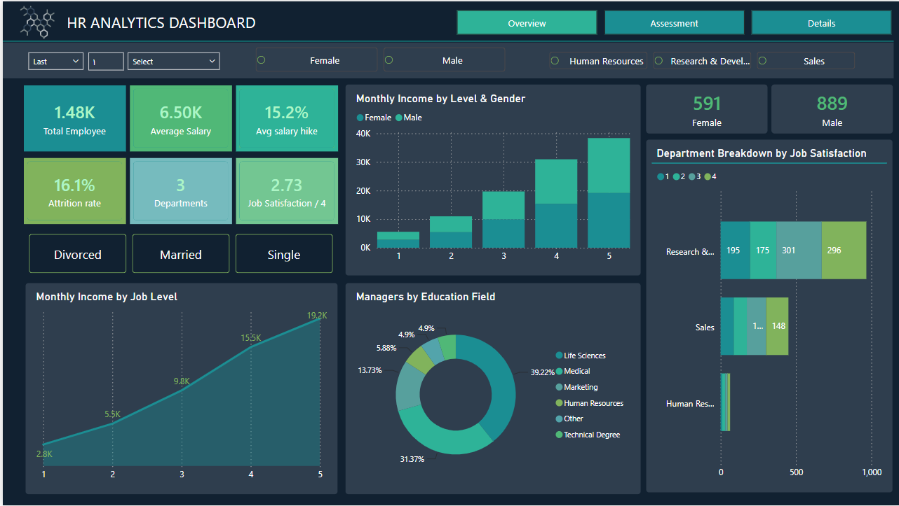

# HR-Analytics-Dashboard-PowerBI
An interactive Power BI dashboard analyzing HR data for 1,480 employees across 3 departments (Human Resources, Research & Development, Sales), focusing on attrition, income, and job satisfaction.
## Key Metrics
- Total employees: 1.48K (591 female, 889 male)
- Average salary: 6.50K
- Average salary hike: 15.2%
- Attrition rate: 16.1%
- Average job satisfaction: 2.73 / 4
## What the dashboard shows
- Monthly income by job level and gender
- Monthly income trend by job level (from 2.8K at level 1 to 19.2K at level 5)
- Managers by education field (Life Sciences is the largest at 39.22%)
- Department breakdown by job satisfaction
- Gender split of employees
## Interactivity
- Filters for gender, department, and marital status
## Tools
- Power BI
## Files
- HR_dashboard.pbix: Power BI project file

